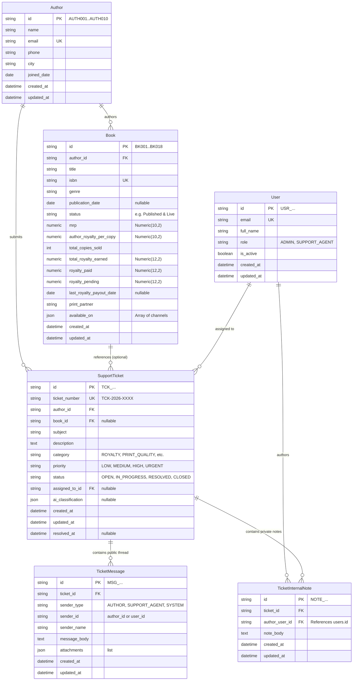

# Architecture Documentation — BookLeaf Author Support & Communication Portal

## 1. System Overview

The **BookLeaf Author Support & Communication Portal** is a production-minded full-stack web application designed for publishing authors and customer support representatives. It provides authors with visibility into their published books, sales figures, and royalty earnings, as well as a centralized helpdesk portal to file inquiries and track ticket resolution.

Phase 1 establishes the **backend foundation, relational data models, database migration pipeline, idempotent seeding service, and comprehensive test suite**.

---

## 2. Technology Stack & Rationale

| Layer / Concern | Technology | Version | Rationale |
| :--- | :--- | :--- | :--- |
| **Runtime** | Python | 3.13 / 3.11+ | Modern language features, strict typing, high performance |
| **Framework** | FastAPI | >= 0.110 | Asynchronous REST framework with automatic OpenAPI docs and dependency injection |
| **ORM & DB Abstraction** | SQLAlchemy | 2.0+ | Declarative typed models (`Mapped`), robust session lifecycle, dialet-agnostic engine |
| **Data Validation** | Pydantic | v2 (`pydantic-settings`) | High performance schema validation, field serialization, computed fields |
| **Database Migrations** | Alembic | 1.13+ | Version-controlled DDL migrations with offline and batch SQLite support |
| **Primary Database** | PostgreSQL | (Production) | ACID-compliant relational engine for hosted deployments |
| **Local Database** | SQLite | 3.x (Local Dev) | Zero-configuration local database with enforced `PRAGMA foreign_keys=ON` |
| **Test Suite** | pytest + HTTPX | 8.0+ | Fixture-based isolated testing with rollback transactions |

---

## 3. Database Architecture & ERD

---

## 4. Key Architectural Patterns

### 4.1 Strict Segregation of Public vs. Private Communications
To fulfill the requirement that author-visible communication be distinguished from internal operational notes:
- **`TicketMessage`** handles the bidirectional author-facing conversation stream. Authors and agents interact through this table.
- **`TicketInternalNote`** represents strictly confidential admin/agent scratchpad discussions and investigations. It is isolated from author queries and foreign-keyed to internal `users`.

### 4.2 Financial Royalty Accounting
- All monetary fields (`mrp`, `author_royalty_per_copy`, `total_royalty_earned`, `royalty_paid`, `royalty_pending`) use **`Numeric(10, 2)` or `Numeric(12, 2)`** to eliminate floating-point rounding errors.
- **Formulas documented in source & models:**
  $$\text{total\_royalty\_earned} = \text{total\_copies\_sold} \times \text{author\_royalty\_per\_copy}$$
  $$\text{royalty\_pending} = \text{total\_royalty\_earned} - \text{royalty\_paid}$$
- Stored values preserve source record values directly, with hybrid helper methods validating mathematical integrity.

### 4.3 Idempotent Seeding Pipeline
The seeding service (`backend/app/services/seed_service.py`):
1. Reads `data/bookleaf_sample_data.json` without altering or fabricating source data.
2. Identifies authors by stable identifier `author_id` (`AUTH001`..) and unique `email`.
3. Identifies books by stable identifier `book_id` (`BK001`..) and unique `isbn`.
4. Executes inside a single transaction: updates existing records if re-run, inserts missing records, and rolls back cleanly on error.
5. **Never deletes or overwrites user-created support tickets**, ensuring seed safety across development cycles.

### 4.4 SQLite & PostgreSQL Multi-Environment Portability
- When running locally against SQLite, SQLAlchemy event hooks automatically issue `PRAGMA foreign_keys=ON` on every DBAPI connection.
- In production, PostgreSQL connection pooling (`pool_size=10`, `max_overflow=20`, `pool_pre_ping=True`, `pool_recycle=1800`) provides high-throughput connection reuse.

---

## 5. Security & Configuration Practices
- No secrets are committed to version control.
- Configuration is loaded via environment variables using `Pydantic Settings`.
- `.env.example` documents all required placeholders.
- Strict `.gitignore` protects credentials, databases, cache directories, and virtual environments.

---

## 6. Authentication & Role-Based Access Control (RBAC)

The authentication subsystem is implemented in `backend/app/core/security.py`, `dependencies.py`, and `auth_service.py`:
- **Password Hashing**: Uses `pwdlib` with Argon2 (`$argon2id$v=19$m=65536,t=3,p=4$...`), providing state-of-the-art resistance to GPU/ASIC cracking and side-channel timing attacks.
- **Token Management**: RFC 7519 compliant JSON Web Tokens (JWT) signed with HMAC-SHA256 (`HS256`).
- **Token Claims**: Contains `sub` (principal ID), `email`, `name`, `role` (`author` or `admin`), `author_id` (if author), `iat`, and `exp`.
- **Server-Side Verification**: Token claims are validated against live database records on every request. Client-supplied headers, query parameters, or payload roles are strictly disregarded.
- **FastAPI Dependency Injection**:
  - `get_current_user`: Extracts, decodes, and validates Bearer tokens.
  - `require_author`: Rejects non-authors with HTTP 403 Forbidden.
  - `require_admin`: Rejects non-administrators with HTTP 403 Forbidden.

---

## 7. Tenant Isolation & Zero-Trust Authorization

Tenant isolation prevents cross-tenant data leakage and privilege escalation:
1. **Identity Derivation**: The author's identity is strictly derived from the validated JWT token (`current_user.author_id`).
2. **Object Ownership Scoping**:
   - `GET /api/v1/author/books`: Automatically filters by `Book.author_id == current_user.author_id`.
   - `GET /api/v1/author/books/{id}`: Returns HTTP 404 if the book exists but belongs to another author (prevents resource enumeration).
   - `GET /api/v1/author/royalties`: Aggregates exclusively books where `author_id == current_user.author_id`.
   - `GET /api/v1/author/tickets/{id}`: Returns HTTP 404 if the ticket belongs to another author.
3. **Write Protection**:
   - When creating a ticket, `ticket_in.book_id` is checked against the author's catalog. If owned by another author, returns HTTP 400 Bad Request.
   - Authors cannot set administrative fields (`priority`, `status`, `assigned_to_id`, `role`, or `ai_classification`). These fields are omitted from author schemas.
4. **Information Hiding**:
   - `TicketInternalNote` records are completely stripped from author-facing schemas and endpoints.
   - Administrative queues (`/api/v1/admin/*`) are protected with strict `require_admin` guards.

---

## 8. Frontend Architecture & Design System

The frontend application (`frontend/`) is implemented using React 19, TypeScript, and Tailwind CSS with a modern publishing-product aesthetic:
- **Routing & Role Protection**: React Router v7 with high-order `ProtectedRoute` enforcing role-based boundaries (`author` vs `admin`). Unauthorized visitors are redirected to `/login` with preserve-redirect queries.
- **State Management**: Centralized `AuthContext` managing JWT token storage, user profiles, session hydration, and reactive logout across browser tabs.
- **Design Tokens**: Warm cream surfaces (`#FAF8F5`, `#F4EFEA`), deep forest brand greens (`#1B382B`, `#2A5742`), subtle shadows, and readable serif/sans typographic hierarchy.
- **Admin Command Center**: Ticket queue sorting, status transitions, staff assignments, category & priority overrides, confidential internal notes, and AI Copilot interaction panels.
- **Production Asset Pipeline**: Vite v8 build pipeline generating optimized static assets with zero TypeScript or linter errors.

---

## 9. Gemini AI Integration Architecture

Implemented in `backend/app/services/ai_service.py` and `knowledge_base.py`:
- **Model**: `gemini-2.5-flash` via official `google-genai` SDK.
- **Triage**: Automatic non-blocking categorization into exactly one of 6 approved categories and 4 priority tiers.
- **Drafting**: Contextual response drafting grounded on BookLeaf's 13 operating policies.
- **Cost Efficiency**: On-demand execution with ticket-level draft caching.
- **Resilience**: Zero-downtime offline heuristic fallback when credentials are unconfigured or provider is unreachable.

